  

# Hi, I'm Patrick Vieyra 👋

### Full Stack Developer | Artificial Intelligence Enthusiast

I'm a Software Engineering student passionate about building digital products, developing scalable applications, and exploring Artificial Intelligence.

I enjoy working across the entire development stack, from designing user interfaces to building backend systems and integrating intelligent solutions.

- 🌍 Based in Senegal
- 🎓 Software Engineering – Pigier Bénin
- 💻 Interested in Full Stack Development & Artificial Intelligence
- 🚀 Currently exploring AI-powered applications and intelligent automation
- 🎯 Goal: Build useful, scalable and innovative digital solutions.

---

<!-- ===================== TECH STACK ===================== -->

## ⚡ TECH STACK

`> technologies I build with, day to day`

 

**Frontend**

  
  
  
  
  

**Backend**

  
  
  
  
  

**Database**

  
  

**Tools & DevOps**

  
  
  
  

**Artificial Intelligence** · *areas of interest & exploration*

  
  
  
  

<!-- ================= END OF TECH STACK ================== -->

---

<!-- ===================== FEATURED PROJECTS ===================== -->

## 🚀 FEATURED PROJECTS

`> selected work: academic and professional`

 

<!-- ---------- Project 1: EduPortal ---------- -->
<blockquote>

<h3>📱 EduPortal</h3>
<code>Mobile app · Academic management</code>

Academic mobile application designed for <b>Pigier Cotonou</b>.

  
  
  
   
  
  
  
  

<b>Features</b>
<ul>
  <li>Academic management</li>
  <li>Notifications</li>
  <li>Secure authentication</li>
  <li>Communication between users</li>
</ul>

<!-- Links (GitHub / Demo) to be added here -->

</blockquote>

 

<!-- ---------- Project 2: AI-Factory Hub ---------- -->
<blockquote>

<h3>🤖 AI-Factory Hub</h3>
<code>Professional project · Full Stack</code>

Professional project carried out during my experience in the <b>AI Factory</b> department at <b>Agiltym by H&amp;C</b>.

  
  
  

<b>Current contribution</b>
<ul>
  <li>Project permissions and access management</li>
</ul>

<!-- Links (GitHub / Demo) to be added here -->

</blockquote>
<!-- ================= END OF FEATURED PROJECTS ================== -->

---

### 📚 Currently Learning

- Artificial Intelligence integration
- AI-powered application development
- Advanced Full Stack Architecture
- Software Engineering best practices

---

<!-- ===================== GITHUB ANALYTICS ===================== -->

## 📊 GITHUB ANALYTICS

`> live statistics from my GitHub activity`

 

 

<!-- ================= END OF GITHUB ANALYTICS ================== -->

---

### 📬 Let's Connect

I'm always interested in collaborating on innovative software projects, exploring new technologies, and learning from other developers.

- 📧 **Email:** [oladebignon@gmail.com](mailto:oladebignon@gmail.com)
- 💼 **LinkedIn:** [Patrick Vieyra](https://www.linkedin.com/in/patrick-vieyra-0494b6391/)
- 💻 **GitHub:** [@patrickvieyra04](https://github.com/patrickvieyra04)

**Building today, innovating tomorrow.** 🚀

<!--
**patrickvieyra04/patrickvieyra04** is a ✨ _special_ ✨ repository because its `README.md` (this file) appears on your GitHub profile.

Here are some ideas to get you started:

- 🔭 I’m currently working on ...
- 🌱 I’m currently learning ...
- 👯 I’m looking to collaborate on ...
- 🤔 I’m looking for help with ...
- 💬 Ask me about ...
- 📫 How to reach me: ...
- 😄 Pronouns: ...
- ⚡ Fun fact: ...
-->
